# Clipboard & Screenshot Archive

**A clipboard history that remembers where every copy came from, reads the text in your screenshots, and diffs two JSON payloads with one shortcut.**

[](https://github.com/ChrystianSchutz/clipboard-screenshot-archive/actions/workflows/ci.yml)
[](LICENSE)
[](#download)

Electron 45 · React 19 · TypeScript 6 · SQLite FTS5 · Tesseract · zod · Playwright

[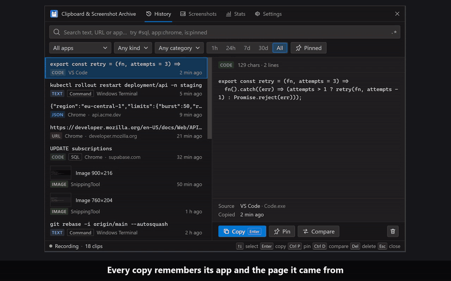](docs/media/demo.mp4)

<sub>Click the GIF for the full-quality MP4. Recorded from the real app in its test sandbox with sample data: `npm run demo:record`.</sub>

You copy a docs link from Chrome, a stack trace from Slack and a SQL query from DBeaver. Two days later you need one of them back. Press `Ctrl+Alt+V`, type `#sql app:dbeaver`, hit `Enter`. Done.

You snip an error with `Win+Shift+S`. It lands in the same history, with its text already read: search `ECONNRESET` and the screenshot shows up; drag across a line to copy it.

Staging and production return "the same" JSON? Copy one, press `Ctrl+Alt+D`, copy the other, press it again. You get the three keys that really differ, not a wall of noise from reordered keys.

Local-first: no account, no cloud, no telemetry. Open source under MIT.

## Download

Get the latest installer from [GitHub Releases](https://github.com/ChrystianSchutz/clipboard-screenshot-archive/releases): NSIS `.exe` for Windows, `.dmg` for macOS, `.AppImage` for Linux, each with a SHA-256 checksum.

The builds are not code-signed yet. Windows SmartScreen will say "Windows protected your PC": click **More info**, then **Run anyway**. macOS Gatekeeper will refuse to open the app the first time: right-click it in Applications, choose **Open**, then confirm. Or build it yourself from source (see [Getting started](#getting-started)).

## Screenshots

|                                                                                                                                            |                                                                                                                                           |
| ------------------------------------------------------------------------------------------------------------------------------------------ | ----------------------------------------------------------------------------------------------------------------------------------------- |
| 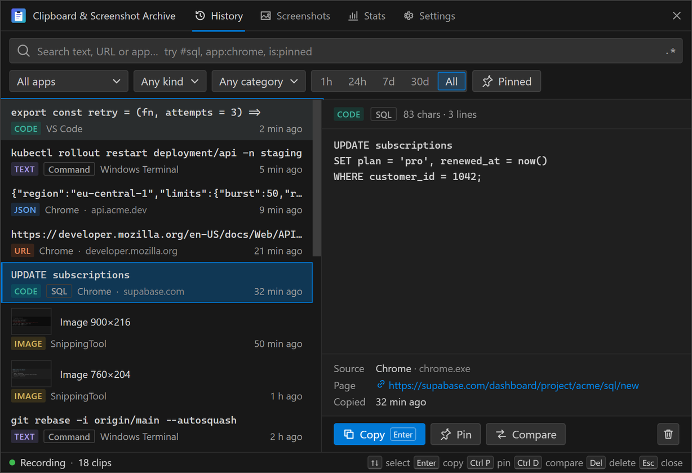 | 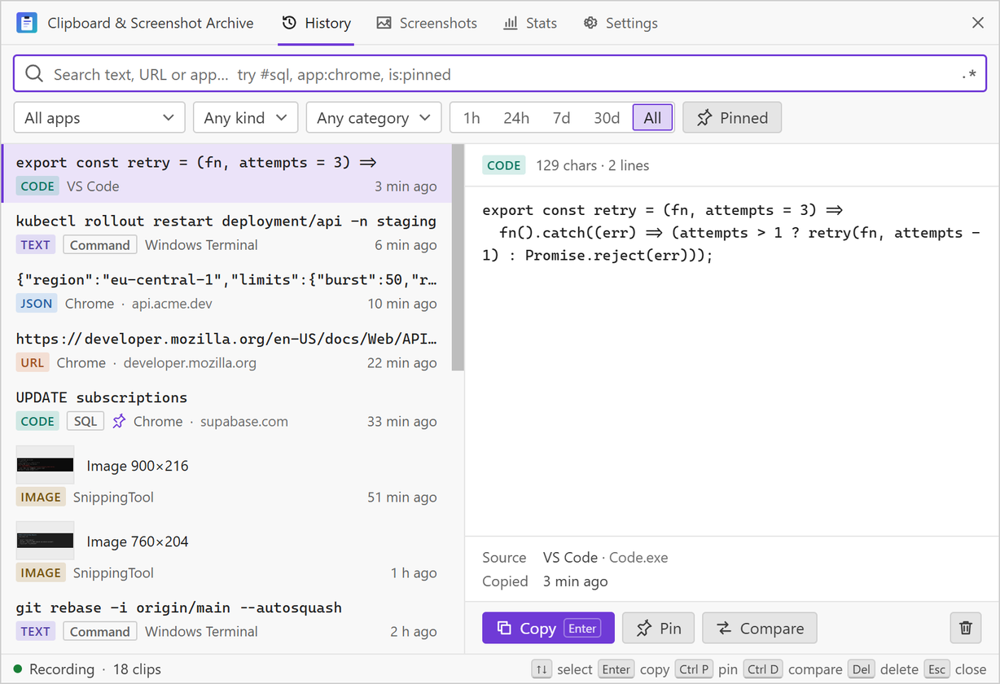                                           |
| 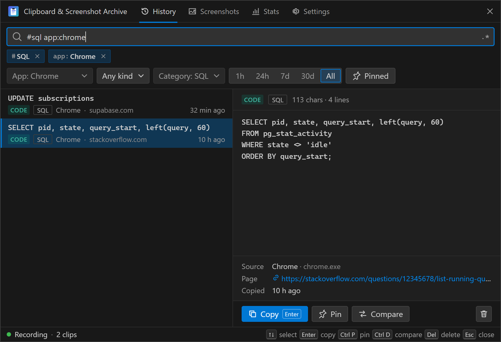                              | 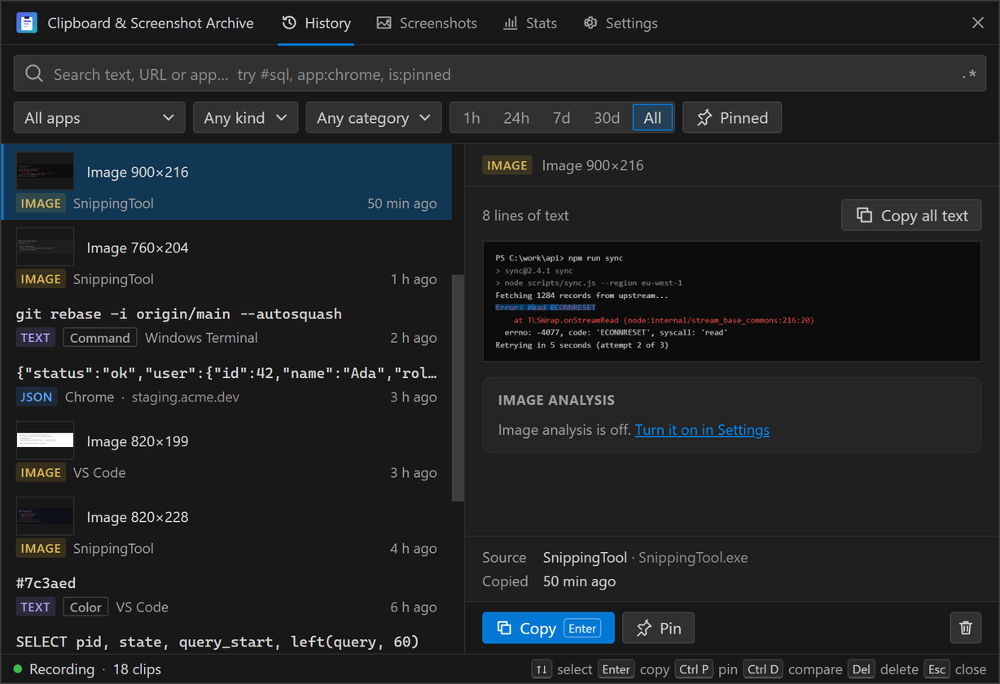        |
| 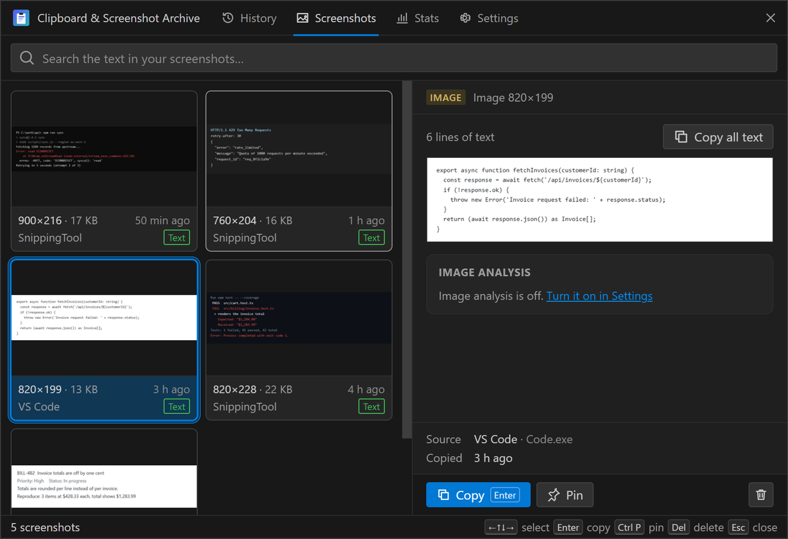            | 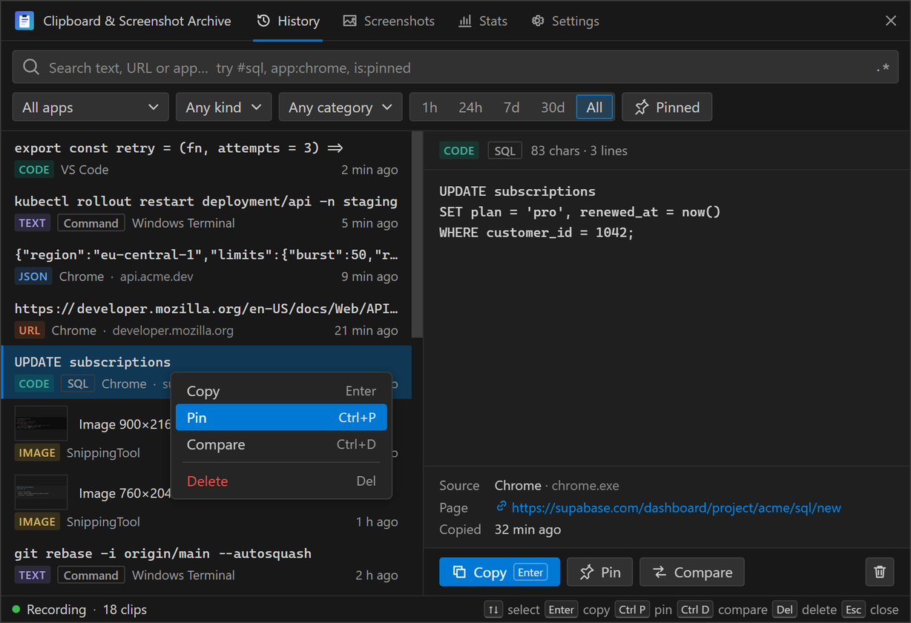                                         |
| 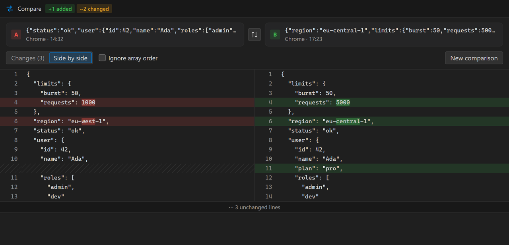                                 | 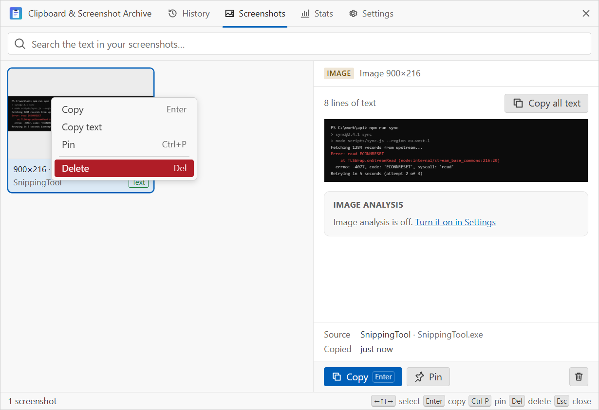 |
| 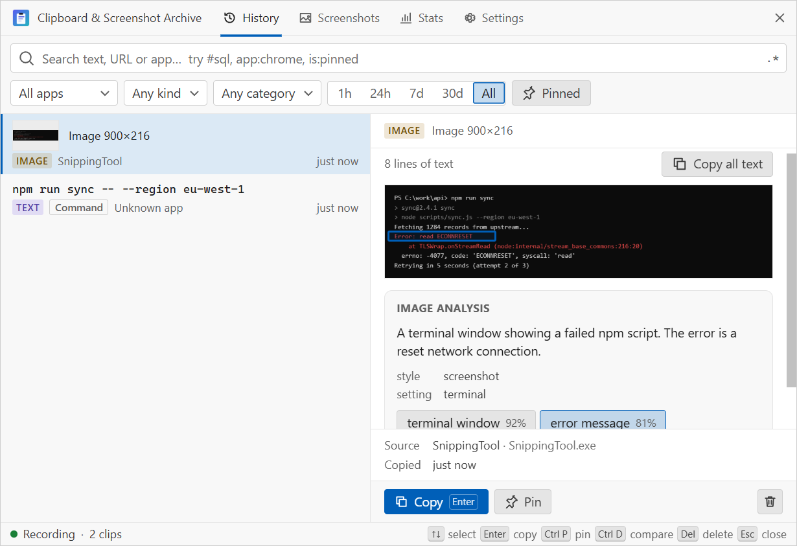                | 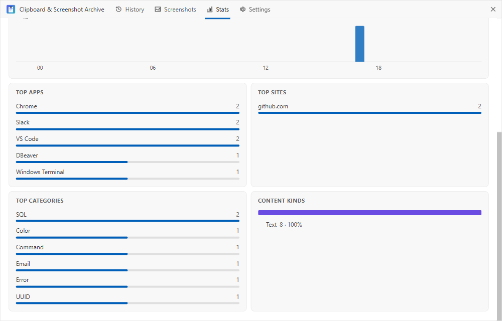                                                  |
| 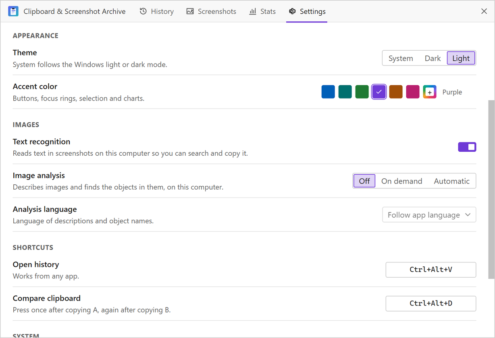                                                        | 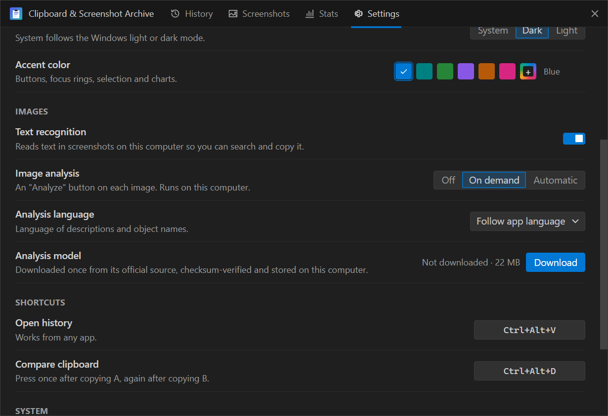                      |

Every screenshot comes from the real app running in the E2E sandbox (see [Testing](#testing)).

## Features

**Clipboard history with provenance.** Every copy is stored with the app that made it (resolved through Win32 `GetClipboardOwner` and the owning process image, shown with a friendly name like "VS Code") and, for browser copies, the page URL read from the `CF_HTML` header that Electron's own clipboard API strips. Copy the same text again and it moves to the top with a copy count instead of duplicating. Pin what you want to keep: pinned clips survive the history size limit.

**Privacy first.**

- Content marked private by its owner is never read: `ExcludeClipboardContentFromMonitorProcessing`, `Clipboard Viewer Ignore` and `CanIncludeInClipboardHistory = 0`, the same markers Windows' own clipboard history honors.
- A "Never record from" list of executables (KeePass, KeePassXC, 1Password and Bitwarden by default).
- Pause capture from the tray or Settings, any time.
- No account, no sync, no telemetry. The history is one SQLite file in your profile. The local error log scrubs quoted text and token-like strings and never stores clipboard content.

**Search that keeps up.** SQLite FTS5 with the trigram tokenizer gives case-insensitive, Unicode-aware substring search over the clip text, its source app, its page URL and the text read from screenshots. Operators keep your hands on the keyboard and show up as removable chips:

| Operator                      | Meaning                                             |
| ----------------------------- | --------------------------------------------------- |
| `#sql`, `#error`, `cat:email` | Clips with that category                            |
| `app:chrome`, `app:"VS Code"` | Copied from that app                                |
| `kind:json`, `is:url`         | Clips of that shape (`json`, `url`, `code`, `text`) |
| `is:pinned`                   | Pinned clips only                                   |

The filter bar does the same with the mouse: app, kind, category, a time range (1h, 24h, 7d, 30d, All) and Pinned.

**Regex when you need it.** Click `.*` or press `Ctrl+R` and the search becomes a regular expression, with every match highlighted in the list. Patterns run in a worker thread with a 250 ms budget, so a runaway pattern gets a friendly "too slow" message instead of freezing the window. Nested quantifiers like `(a+)+` are refused up front.

**Auto categories.** Twelve strict, local rules tag each clip at capture time: Secret, Error, SQL, Command, Email, File path, UUID, IP address, Color, Number, Markdown, HTML. A clip can carry several. Secrets (private keys, JWTs, Stripe, GitHub, AWS, Slack and similar tokens) get tagged, so `#secret` finds them fast and you can delete them.

**Stats.** Copies today, totals, a 14-day chart, copies by hour of day, top apps, top sites, top categories and content kinds. Every chart has a table view.

**Compare on a shortcut.** Press the compare shortcut after copying A and again after copying B. JSON is diffed structurally: key order is ignored, paths are shown as `$.user.plan`, 64-bit ids like `9007199254740993` keep their exact value, and "Ignore array order" turns arrays into multisets. Switch between a list of changes and a side-by-side view with word-level highlights. Anything that is not JSON falls back to a side-by-side line diff. You can also mark two clips in the history with `Ctrl+D` and compare them.

### Screenshots: text you can select, analysis on demand

Press `Win+Shift+S`, snip a stack trace, and it lands in your history as an image. Two local engines, two jobs:

**Text you can select.** Tesseract (English and Polish, `tessdata_fast`) reads every screenshot in a separate utility process, off the main thread. The words sit on a transparent layer over the image, so you drag to select a line, or hit "Copy all text". The text goes into the same FTS5 index as everything else. Small captures are upscaled 2x before recognition, which cut the character error rate on code screenshots from 19.6% to 2.0% in our benchmark ([`image-engines.test.ts`](src/main/benchmarks/image-engines.test.ts)).

**Image analysis on demand.** Cactus Mirage, a 22 MB vision model, describes the screenshot and names the objects in it; click an object and it is outlined on the image. You choose: **Off** (the default), **On demand** (an "Analyze" button) or **Automatic**, plus the language of the descriptions. The weights download once over HTTPS, from a pinned revision, and are checked against their exact size and SHA-256 before they are written to disk. They run on your CPU through WebAssembly. Descriptions are searchable too.

**The Screenshots tab.** Every capture in one gallery, newest first, with size, source app and a "Text" badge once it has been read. Search box on top searches the text inside the images. Arrow keys move through the grid in all four directions; the preview, text layer and analysis sit on the right.

Nothing leaves your machine. Screenshot pixels are served only to the history window through a dedicated `clip-image://` scheme. On macOS, importing from the screenshot folder is opt-in (off by default) and only accepts new files macOS itself marks as screen captures.

### Right-click menu

Right-click any clip, or press `Shift+F10` or the Menu key on the selected one. Text clips get **Copy**, **Pin**, **Compare** and **Delete**; screenshots get **Copy**, **Copy text**, **Pin** and **Delete**. Each item shows its shortcut, and the menu is fully keyboard-driven (arrows, `Home`, `End`, `Enter`, `Esc`).

### Themes and accent

Colors follow VS Code's Dark Modern and Light Modern. Pick System, Dark or Light, then one of six accent presets (Blue, Teal, Green, Purple, Orange, Pink) or any custom color. A custom accent is checked against WCAG 2.x: if it falls under 3:1 against the surfaces (4.5:1 when used as text), only its lightness moves until it passes, and the label ink on top switches between black and white.

### The tray

The app lives in the tray. Its menu: Open history, Screenshots, Compare clipboard, Statistics, Pause capture, Launch at login, Settings and Quit. The global shortcuts are shown next to their items.

### Keyboard shortcuts

| Where            | Keys                                | Action                                                          |
| ---------------- | ----------------------------------- | --------------------------------------------------------------- |
| Anywhere         | `Ctrl+Alt+V` (`Cmd+Alt+V` on macOS) | Open or hide the history                                        |
| Anywhere         | `Ctrl+Alt+D` (`Cmd+Alt+D` on macOS) | Compare: press after copying A, again after copying B           |
| Window           | `Ctrl+1` to `Ctrl+4`                | History, Screenshots, Stats, Settings                           |
| History          | `↑` `↓`, `PgUp` `PgDn`              | Move the selection                                              |
| Screenshots      | `←` `↑` `→` `↓`, `Home` `End`       | Move through the gallery                                        |
| History, gallery | `Enter`                             | Put the clip back on the clipboard (not recorded as a new copy) |
| History, gallery | `Ctrl+P`                            | Pin or unpin                                                    |
| History          | `Ctrl+D`                            | Mark as A, then compare with the next clip                      |
| History, gallery | `Del`                               | Delete                                                          |
| History, gallery | `Shift+F10` or the Menu key         | Open the right-click menu                                       |
| History          | `Ctrl+R`                            | Toggle regex search                                             |
| History          | `Esc`                               | Clear the mark, then the search, then hide                      |
| Compare          | `Esc`                               | Hide the compare window                                         |

Both global shortcuts can be re-recorded in Settings. If a new one is taken by another app, the previous pair is restored and you get a readable error.

## Why it's built this way

Notes for engineers. Each point links to the code.

**Ports and adapters around the OS clipboard.** The capture pipeline ([`capture-service.ts`](src/main/clipboard/capture-service.ts)) only knows three small interfaces ([`ports.ts`](src/main/clipboard/ports.ts)): `ClipboardIO` (read and write text), `SourceProbe` (who owns the clipboard, is it private, which clipboard version is this) and `ClipboardWatcher` (tell me when it changes). Windows gets an event-driven watcher on `WM_CLIPBOARDUPDATE` plus a Win32 probe; macOS polls the native `NSPasteboard` change count; Linux gets a 500 ms fingerprint poller; tests get plain fakes. Every privacy rule and race fix is unit-tested without Electron.

**One composition root.** [`ClipboardArchiveApp`](src/main/app/clipboard-archive-app.ts) builds every service once, wires them together and owns their lifetime. It is also the only place that decides between the real OS adapters, the E2E sandbox and the packaged-app smoke mode. [`index.ts`](src/main/index.ts) only handles process concerns: single-instance lock, profile path, lifecycle.

**A typed IPC contract, validated at runtime.** [`ipc-contract.ts`](src/shared/ipc-contract.ts) declares every channel once, with its argument tuple and result. Main registers handlers through a mapped type, so a missing or mistyped handler is a compile error. The zod schemas ([`schemas.ts`](src/main/ipc/schemas.ts)) are declared `satisfies Record<InvokeChannel, z.ZodType>`, so a channel without a schema does not compile either. At runtime each call passes two gates ([`register.ts`](src/main/ipc/register.ts)): the sender check, then a strict zod tuple. The preload exposes a narrow facade over 24 channels, never `ipcRenderer` itself, and never leaks the `IpcRendererEvent` to page code.

**A serial capture queue bound to the clipboard version.** Reading the clipboard is async; the owner can change while you wait. So the probe runs synchronously at notification time and records `GetClipboardSequenceNumber`. The text is read later, in a promise-chain queue that processes changes strictly in arrival order, and only kept if the sequence number is unchanged before and after the read. Otherwise the change is dropped as superseded: the newer copy has its own notification. A password copied while an older change waits in line can never be saved under the older, non-private metadata. The compare shortcut uses the same idea: the A/B slot is taken at key press, so slow reads cannot swap A and B ([`compare-session.ts`](src/main/compare/compare-session.ts)).

**Keyset pagination.** The history is ordered by `(last_copied_at DESC, id DESC)` with a matching index. The next page asks for rows strictly after the last `(last_copied_at, id)` pair and fetches `limit + 1` rows to know if there is more. No `OFFSET`, so page 50 costs the same as page 1 and rows never shift when a new copy lands mid-scroll ([`clip-repository.ts`](src/main/storage/clip-repository.ts)).

**Forward-only migrations.** The schema version lives in `PRAGMA user_version`. Each step runs in its own `BEGIN IMMEDIATE` transaction together with the version bump, so it applies fully or not at all. A step can be SQL or a TypeScript function, which lets v2 backfill categories with the same rules the app uses at capture time. An app that finds a newer schema than it knows refuses to open it instead of guessing ([`migrations.ts`](src/main/storage/migrations.ts)). Storage is Node's built-in `node:sqlite`: no native module to rebuild per Electron ABI.

**Why FTS5 trigram.** People search clipboards for fragments: half a URL, the tail of a UUID, a word inside `camelCase`. Word tokenizers miss those; trigram matches any substring of 3+ characters, case-insensitively and Unicode-aware (`łódź` finds `ŁÓDŹ`). The index is contentless (`content = ''`, `contentless_delete = 1`), so text is stored once. What is searchable is defined in exactly one SQL view, `clip_search_documents`, which triggers feed into the index. User words are quoted as FTS phrases, so `AND`, `*` or `"` in a query are matched literally. Words under 3 characters fall back to a scan; regex mode bypasses FTS. Measured on 50,000 generated clips (median of 15 runs, first page of 60, one local run on Windows 11 with Node 24):

| Query                                          |    Time | Rows |
| ---------------------------------------------- | ------: | ---: |
| Common word (`timeout`)                        | 35.9 ms |   60 |
| Two words (`invoice payment`)                  | 24.0 ms |   60 |
| Word + app (`deploy app:Slack`)                | 15.3 ms |   60 |
| Word + category (`customer #sql`)              | 12.6 ms |   60 |
| Category only (`#email`)                       |  9.0 ms |   60 |
| Rare substring (`#49999`)                      | 0.15 ms |    1 |
| No match (`zzzqqq`)                            | 0.08 ms |    0 |
| Same no-match query as a full scan, before FTS | 51.6 ms |    0 |
| Short word, scan fallback, no match (`qx`)     | 67.9 ms |    0 |

The suite fails if any of the eight budgeted queries (the first seven rows, plus a three-word query) takes over 100 ms. The benchmark is opt-in because seeding takes a few seconds: `npm run test:bench`, or `BENCH=1 npx vitest run src/main/storage/search-performance.test.ts --silent=false` to see the numbers.

**koffi instead of a native addon.** Change notifications, the clipboard owner, private-format markers and the raw `CF_HTML` header are not in Electron's API. A C++ addon would mean a compiler toolchain and a rebuild for every Electron ABI. [koffi](https://koffi.dev) is a prebuilt FFI, so the Win32 calls are declared as C signatures in TypeScript ([`user32.ts`](src/main/clipboard/win32/user32.ts)). Two gotchas are documented in the code:

- **The V8 memory cage.** `koffi.view()` wraps native memory in an external `ArrayBuffer`. Electron runs V8 with the memory cage (sandbox) on, which forbids that, and the process aborts on first use. The adapter copies bytes with `koffi.decode()` instead.
- **`BOOL` is 32 bits.** koffi's `bool` is one byte; Win32 `BOOL` is an `int`. The bindings return `int32_t` and convert at the adapter boundary.

koffi is the only package kept out of the bundle and unpacked from `app.asar`, since a `.node` binary cannot be loaded from inside the archive.

**An E2E sandbox that never touches your desktop.** With `CLIPBOARD_ARCHIVE_E2E=1` the composition root swaps two ports: an in-memory clipboard and a scripted source probe. Windows are created and rendered but never shown, background throttling is off so they keep painting, and there is no tray icon and no global shortcut. Each test gets a fresh temp profile. Playwright drives the real app (real IPC, SQLite, React) and simulates "Chrome copied this from github.com" through a main-process hook. The suite runs in parallel, in the background, on any OS, and never overwrites your clipboard.

## Security checklist

How the app maps to [Electron's security recommendations](https://www.electronjs.org/docs/latest/tutorial/security):

| Recommendation              | How it is met                                                                                                                                                                                                                                        |
| --------------------------- | ---------------------------------------------------------------------------------------------------------------------------------------------------------------------------------------------------------------------------------------------------- |
| Context isolation           | `contextIsolation: true` on every window ([`windows.ts`](src/main/app/windows.ts))                                                                                                                                                                   |
| Process sandbox             | `sandbox: true`, `nodeIntegration: false`; the preload is one self-contained CJS file, as sandboxed preloads require                                                                                                                                 |
| Content Security Policy     | `default-src 'none'`; scripts, styles and fonts from `'self'` only; no inline script, no `eval`; `base-uri`, `form-action`, `frame-ancestors` locked ([`index.html`](src/renderer/index.html)). Relaxed only by the dev server, never in builds      |
| No remote content           | The UI is bundled and served from a custom `app://bundle/` origin. The protocol handler serves only files inside the renderer folder and rejects `..`, encoded separators and other hosts ([`app-protocol.ts`](src/main/app/app-protocol.ts))        |
| Isolate heavy work          | OCR and image analysis run in separate utility processes with no window and no access to app IPC; their results are validated with zod before they reach the database                                                                                |
| Limit navigation            | `will-frame-navigate` and `will-redirect` allow only the main frame, and only the exact app document ([`security.ts`](src/main/app/security.ts)). `<webview>` is blocked                                                                             |
| Limit new windows           | `setWindowOpenHandler` denies every window; `http(s)` links (a clip's source page) open in the default browser, any other scheme is dropped                                                                                                          |
| Permission requests         | Every permission request and check is denied                                                                                                                                                                                                         |
| Validate the IPC sender     | Each call must come from one of the app's windows, from its main frame, while it shows the app document, on a channel that window's role may use. The compare window gets 6 of the 24 channels ([`sender-policy.ts`](src/main/ipc/sender-policy.ts)) |
| Validate IPC input          | Strict zod tuple per channel; regex patterns are length-capped, nested quantifiers like `(a+)+` are refused, and matching runs in a worker that is killed after 250 ms                                                                               |
| Do not expose Electron APIs | The renderer sees only `window.clipboardArchive`, a typed facade; E2E checks that `require` and `process` are absent and the bridge has exactly its seven namespaces                                                                                 |
| Fuses                       | `runAsNode`, `NODE_OPTIONS`, `--inspect` and extra `file://` privileges off; cookie encryption on ([`electron-builder.yml`](electron-builder.yml))                                                                                                   |
| ASAR integrity              | `enableEmbeddedAsarIntegrityValidation` and `onlyLoadAppFromAsar`: a tampered `app.asar` or a loose `app/` folder will not load                                                                                                                      |
| Network                     | None by default. The only request is the opt-in image-model download: HTTPS, pinned revision, size and SHA-256 checked before it touches disk. Tesseract runs offline with bundled language data                                                     |
| Current Electron            | Electron 45, pinned                                                                                                                                                                                                                                  |

The E2E suite checks the renderer surface, navigation blocking (to a website and to another local HTML file), malformed IPC arguments and the compare window's channel limits.

## Testing

| Layer          | What                                                                                                                                                                                        | Run                                                  |
| -------------- | ------------------------------------------------------------------------------------------------------------------------------------------------------------------------------------------- | ---------------------------------------------------- |
| Unit           | Pure logic: JSON diff, search parser, categories, color contrast, capture rules, IPC sender policy, compare state machine, context menu, gallery navigation, Win32 adapter on fake bindings | `npm test`                                           |
| Integration    | Real `node:sqlite` in memory: repository, migrations, FTS triggers, settings store; worker threads; model download and verification                                                         | `npm test`                                           |
| Benchmark      | 50,000 clips, nine query shapes, 100 ms budget                                                                                                                                              | `npm run test:bench`                                 |
| E2E            | 67 Playwright tests against the built Electron app in the sandbox: capture, search, operators, compare, privacy, screenshots and OCR, the gallery, the context menu, themes, security       | `npm run test:e2e`                                   |
| Packaged smoke | Launches the packaged EXE hidden; checks that koffi loads, the Win32 listener registers, React renders and IPC round-trips through the preload                                              | `npm run package && node scripts/smoke-packaged.mjs` |

Vitest runs 1,789 unit and integration tests in 88 files. 17 more are skipped by default: opt-in benchmarks and a few checks that need an OS feature (such as symlinks). Of the 67 E2E tests, 62 run by default; the other 5 only capture screenshots for the README and for visual review. `npm run check` runs typecheck, ESLint, Prettier and the unit suite in one go.

The E2E suite is windowless: windows are rendered but never shown, the clipboard is an in-memory fake, and every test gets a fresh temp profile. Run it while you work; it never steals focus or touches your clipboard.

[CI](.github/workflows/ci.yml) runs on every push and pull request:

1. Typecheck, lint, format check, unit tests with V8 coverage (Ubuntu).
2. E2E on Windows and on Ubuntu under `xvfb`.
3. Package with electron-builder and smoke-test the packaged app (Windows), including one real OS clipboard copy and one private copy that must be skipped.

## Getting started

Requires Node 24+.

```bash
npm ci
npm run dev        # electron-vite dev server with hot reload
```

The app starts in the tray. Press `Ctrl+Alt+V` to open the history. Note that the dev build records your real clipboard, like the installed app.

Source app and page detection use Win32 and are Windows-only. On macOS and Linux the history, search, screenshots, compare and stats work the same, with no source attribution.

## Build and package

```bash
npm run build      # production build into out/
npm run package    # unpacked app in release/<version>/
npm run dist       # installers: NSIS (Windows), DMG (macOS), AppImage (Linux)
```

Pushing a `v*` tag runs the [release workflow](.github/workflows/release.yml): it builds all three installers unsigned, adds SHA-256 checksums and drafts a GitHub Release.

## Project structure

```
src/
  main/
    app/          composition root, windows, tray, shortcuts, security, app:// protocol
    clipboard/    capture pipeline, ports, watchers, privacy rules, Win32 and macOS adapters (koffi)
    images/       image capture, image store, clip-image:// protocol, macOS screenshot folder
    ocr/          Tesseract text recognition in a utility process
    analysis/     Cactus Mirage image analysis in a utility process
    models/       model download: pinned URL, size and SHA-256 check
    workers/      worker and utility-process plumbing shared by OCR, analysis and regex
    search/       regex search in a worker thread with a time budget
    compare/      two-press compare state machine
    storage/      node:sqlite, migrations, FTS5 search, repository, settings
    ipc/          zod schemas, sender policy, handler registration
    diagnostics/  local JSONL error log
    benchmarks/   OCR and image-engine benchmarks (opt-in)
  preload/        the typed contextBridge facade
  shared/         code used by both sides: IPC contract, JSON diff, search parser, theme math
  renderer/src/
    features/     history, screenshots (gallery), ocr (text layer), compare, stats, settings
    components/   shared UI: ContextMenu, category chips, icons, primitives
tests/e2e/        Playwright specs and the sandbox fixture
scripts/          packaged smoke test, demo recorder, icon and OCR fixture generators
docs/             architecture notes, screenshots, demo media, reviews
```

Deeper dive: [docs/ARCHITECTURE.md](docs/ARCHITECTURE.md).

## Known limits and roadmap

- **Unsigned builds.** Installers are not code-signed or notarized yet, so SmartScreen and Gatekeeper warn on first launch (see [Download](#download)).
- **Source attribution is Windows-only.** macOS and Linux record the clip but not the app or page it came from, and the "Never record from" list cannot apply there.
- **Linux change detection is a fingerprint.** Windows and macOS have a native clipboard counter; Linux polls every 500 ms. Two image-only copies in a row with the same formats are told apart only by a 2-second image probe, so if the second image is replaced before the next probe, it is lost. Electron also has no payload-free size check for clipboard images, so an oversized image left on the clipboard is decoded natively every 2 s before it is refused. Details in [docs/ARCHITECTURE.md](docs/ARCHITECTURE.md).
- **macOS screenshots are opt-in.** `Cmd+Shift+3/4/5` save to a folder rather than the clipboard. Turn on "Import screenshots from the screenshot folder" in Settings to add them; older files in the folder are never imported.
- **Text recognition reads English and Polish.** Other languages are not bundled yet.

## Contributing

Issues and pull requests are welcome. Read [CONTRIBUTING.md](CONTRIBUTING.md) first: it covers setup, `npm run check`, the E2E sandbox rules and the one folder Prettier must never touch.

To re-record the demo and the README screenshots taken from it: `npx electron-vite build && node scripts/record-demo.mjs` (`npm run demo:record`). It drives the real app in the E2E sandbox with seeded sample data, never shows a window and never touches your clipboard. It needs `ffmpeg` on the `PATH`. The other README screenshots come from the E2E specs: `CLIPBOARD_ARCHIVE_SCREENSHOTS=1 CLIPBOARD_ARCHIVE_SEARCH_SHOTS=docs/screenshots npx playwright test`.

## Security

Found a vulnerability? Please report it privately, as described in [SECURITY.md](SECURITY.md), not in a public issue.

## License

[MIT](LICENSE)
