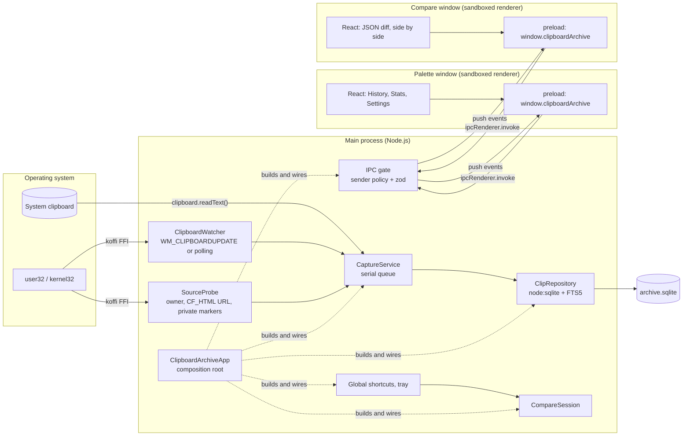

# Architecture

How Clipboard & Screenshot Archive is put together: processes, the path of one copy, the path of a compare, the storage schema and the trust boundaries. File links point at the code that implements each part.

## Process model

- **Main process.** Owns everything with side effects: the clipboard, Win32 calls through [koffi](https://koffi.dev), SQLite through Node's built-in `node:sqlite`, global shortcuts, the tray, windows. [`ClipboardArchiveApp`](../src/main/app/clipboard-archive-app.ts) is the composition root: it builds each service once, injects the ports and is the single place that picks real adapters, the E2E sandbox or the packaged smoke mode.
- **Two renderer windows**, both `sandbox: true`, `contextIsolation: true`, no Node:
  - **Palette**: frameless, always on top, created hidden at startup and kept alive, so the shortcut shows it instantly. On Windows its HWND also hosts the clipboard listener.
  - **Compare**: created on first use. The JSON diff runs here, in pure TypeScript ([`json-diff.ts`](../src/shared/json-diff.ts)).
- **Preload.** One self-contained CommonJS file ([`preload/index.ts`](../src/preload/index.ts)) exposes a typed facade over 27 invoke channels and 6 push events. The renderer never touches `ipcRenderer`.
- **Shared code** ([`src/shared`](../src/shared)) is pure: the IPC contract, types, search parser, categories, JSON and text diff, color math. Both sides import it, so the contract cannot drift.

Platform adapters, chosen once at startup:

| Platform                                         | Watcher                                                                                                                       | Source probe                                                           |
| ------------------------------------------------ | ----------------------------------------------------------------------------------------------------------------------------- | ---------------------------------------------------------------------- |
| Windows                                          | `AddClipboardFormatListener` + `WM_CLIPBOARDUPDATE` via `hookWindowMessage`, 60 ms debounce, de-duplicated by sequence number | Win32: owner process, `CF_HTML` `SourceURL`, private-format markers    |
| Windows, listener failed                         | 500 ms poll of `GetClipboardSequenceNumber` (exact; the failure is logged, the app keeps recording)                           | Win32                                                                  |
| macOS                                            | 500 ms poll of `NSPasteboard.generalPasteboard.changeCount` via the Objective-C runtime (koffi, in-process; exact)            | None: no source, no app exclusion; reads are bound to the change count |
| Linux, other; macOS if the counter fails to load | 500 ms fallback fingerprint: format list, write-marker token, text hash; image bytes at most every 2 s                        | None: no source, no app exclusion                                      |
| E2E sandbox                                      | None: tests call `copy()`                                                                                                     | Scripted by the test                                                   |

Change detection is **exact** on Windows and macOS: a native counter moves on every write by any app, so image-only copies and an identical copy right after a restore are all seen, and nothing is read from the clipboard to notice a change. The counter also versions each capture: text and pixels are dropped as `superseded` when it moved meanwhile.

Linux and other platforms use the **fallback fingerprint** (`PollingClipboardWatcher`). Every poll reads the format list (`clipboard.read()` item types, no payload), the app's write-marker token and the text. An identical copy from another app right after the app's own restore is still seen, because the marker disappears. The image payload is read only when the clipboard holds an image and no text: at once after each cheap change (format list, marker, text hash), then every 2 s while it stays the same. A poll takes the capture generation when it begins, so a copy sampled while capture was paused is never recorded, even if capture resumes before the read ends. Without a counter, an image capture is bound to the write marker read with the text, checked right before and right after the pixel read, so a restore that replaced the image while the capture waited is never stored.

**Known limit of the app's own writes:** a restore or a composed copy (joined clips, a screenshot's text) is skipped only by its write marker; where the marker cannot be read, it is recorded once as an ordinary clip, never by guessing from the text, so a genuine identical copy is never lost.

**Known limits of the fallback fingerprint** (Windows and macOS use native counters and have neither):

- Two image-only copies in a row with the same formats are told apart only by the 2 s image probe. If the second image is replaced (for example by a text copy) before the next probe, it is lost: it is no longer on the clipboard when the change is noticed.
- Electron offers no payload-free size check for a clipboard image. The probe asks the platform clipboard for the PNG, which Electron decodes and re-encodes natively, before the size check can refuse an oversized one. Above the capture limit the bytes are never copied into JS memory or hashed, but the native materialization cannot be avoided; an image left on the clipboard costs one such read every 2 s.
